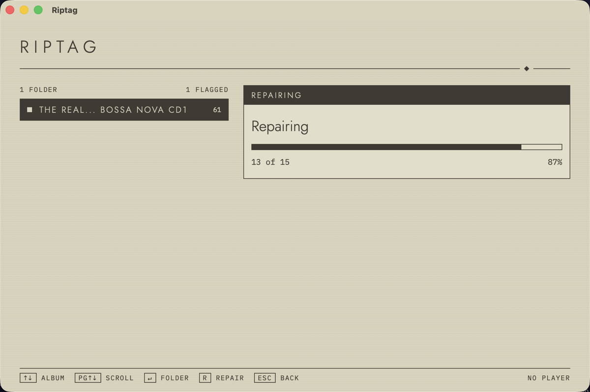
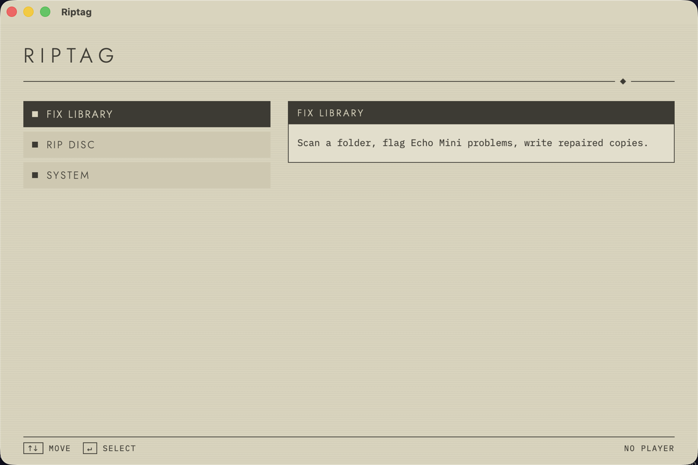

<div align="center">

# R I P T A G

**Music files your FiiO Snowsky Echo Mini handles properly.**

A small, keyboard-driven desktop app that repairs your music library for the Echo Mini,<br>
and will soon rip CDs straight into the same shape.

[](https://github.com/Redseb/riptag/actions/workflows/ci.yml)
[](LICENSE)




</div>

## Why

The Echo Mini is fussy. Covers can fail to show, unsupported tags can hide the ones it does read, and because it browses by folder, your folder layout *is* its interface.

Great rippers and taggers already exist. Riptag does one narrower thing: every file it writes follows a profile of what this player needs.

## What it does

Point it at a folder and it shows a diagnosis for each album. Then:

| | Problem | What Riptag writes |
|---|---|---|
| **ART** | PNG, progressive, oversized or non-square covers | A centre-cropped baseline JPEG of up to 600 px, embedded and as `cover.jpg` |
| **TAG** | Tags that can hide others, ID3v2.4 | Whitelisted fields only, with ID3v2.3 for MP3 |
| **FMT** | AIFF, which the player can't play | FLAC, written only if the decoded audio matches the source exactly |
| **FS** | Illegal characters, long paths, decomposed Unicode | FAT-safe, normalised names in the folder layout below |
| **LRC** | No lyrics | Synced `.lrc` files from [LRCLIB](https://lrclib.net) beside each track |

```text
Artist/
└── 2014 - Album/
    ├── cover.jpg
    ├── 01 Title.flac
    └── 01 Title.lrc
```

Multi-disc albums get `CD1` and `CD2` subfolders, each with its own cover. Then press `S` to copy the result to a connected player.

## Your music is safe

- **Originals are never changed.** Repair only reads them and refuses an output folder that overlaps the source.
- **Nothing gets overwritten.** Repair and sync both skip existing files and tell you which.
- **Nothing is removed from your player.** Sync checks free space first, and copies only after you confirm the volume.
- **Copies are verified.** Each file reaches the player under a temporary name and is compared with the original before it's renamed.

## Built for the keyboard



| Key | Action |
|---|---|
| `↑` `↓` | Move through rows |
| `↵` | Select, or choose a folder |
| `R` | Repair into a separate folder |
| `L` | Fetch lyrics for the repaired copies |
| `S` | Sync to the player |
| `Esc` | Back |

The look is a muted, hairline terminal, inspired by the menus of NieR:Automata. It's an influence only, with no game assets, logos or fonts.

## Status

Early, and not yet packaged for download.

- [x] **Fix library:** scan, diagnose, repair, convert AIFF, fetch lyrics, sync
- [x] **Menu interface**
- [ ] **Ripping on Mac:** MusicBrainz lookup, then an error-corrected rip with `cd-paranoia`
- [ ] **Windows**

Tried on a real Echo Mini so far: a repaired FLAC album with a 452 px cover, its tags and accented names. Still untested on the device: full 600 px covers, `.lrc` display, MP3, OGG and M4A output, and writing to it with `S`. Tags on APE, WAV, WMA and DSD files aren't cleaned yet, and those files are copied as they are.

## Development

You'll need Node 24, stable Rust, the [Tauri prerequisites](https://tauri.app/start/prerequisites/) and `ffmpeg`.

```sh
brew install ffmpeg
npm install
npm run tauri dev
```

| Command | What it does |
|---|---|
| `npm test` | Frontend tests |
| `npm run build` | Type-check and bundle the frontend |
| `npm run bundle` | Build the packaged app, with its own minimal `ffmpeg` |
| `cargo test` | Backend tests, run in `src-tauri/` after `npm run build` |

Built with [Tauri](https://tauri.app), Rust and React, using [lofty](https://github.com/Serial-ATA/lofty-rs) for tags and [image](https://github.com/image-rs/image) for covers.

## License

Riptag is under the [MIT License](LICENSE). The packaged app also includes FFmpeg, as a separate program under the LGPL 2.1 or later: see [its notice](licenses/ffmpeg-NOTICE.txt).

Riptag isn't affiliated with FiiO or Snowsky.
